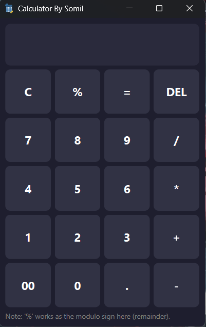

<p align="center">
  
</p>

# PyQt6 Desktop Calculator

A clean, dark-themed desktop calculator built from scratch with **Python** and **PyQt6**, featuring custom icon design, responsive full-screen scaling, and full physical keyboard support.

## Features
- **Modern Dark UI:** Custom QSS styling with hover and press states.
- **Full Keyboard & Mouse Support:** Type numbers and operators directly (`0–9`, `+`, `-`, `*`, `/`, `%`, `.`), press `Enter` to evaluate, and `Backspace` to delete.
- **Smart Input Handling:** Automatically swaps consecutive operators and clears `"Error!"` states on the next keypress.
- **Responsive Layout:** Expands cleanly from compact window size to full screen.
- **Standalone Windows Executable:** Packaged with PyInstaller and a custom-designed app icon.

## Preview
<p align="center">
  
</p>

## Run from Source
```bash
pip install -r requirements.txt
python Calculator.py
```

## Download (Windows)
Grab the standalone `.exe` directly from the **[Releases](../../releases)** tab—no Python installation required!
